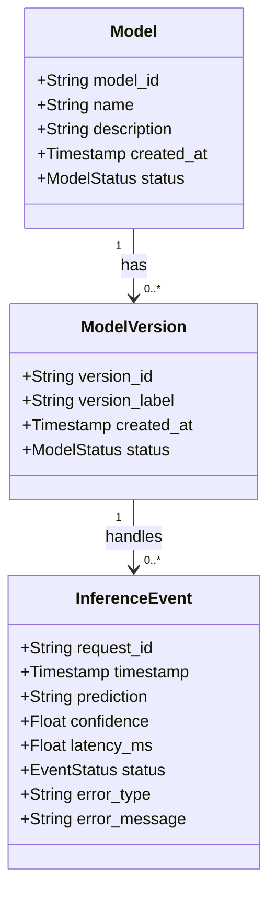

# RedisPulse — M2 Conceptual Data Model

## 1. Purpose

This document describes the conceptual data model of RedisPulse, independently of Redis implementation details.

The model represents the information needed for:

- Model and version management.
- Continuous inference-event ingestion.
- Event retrieval, filtering, and error investigation.
- Operational monitoring and version comparison.

The conceptual model contains three entities: **Model**, **ModelVersion**, and **InferenceEvent**.

Monitoring metrics are derived from inference activity and are not modeled as a separate conceptual entity.

## 2. UML Class Diagram

**Identifiers:**
- `Model.model_id`
- `ModelVersion.version_id`
- `InferenceEvent.request_id`

**Enumerations:**
- `ModelStatus`: active, archived.
- `EventStatus`: success, error.

Optional attributes and additional constraints are described below.

## 3. Entity Definitions

### 3.1 Model

Represents an LLM registered in RedisPulse.

**Identifier:** `model_id`

| Attribute | Description | Constraint |
|---|---|---|
| model_id | Unique model identifier | Required |
| name | Model name | Required |
| description | Model description | Required |
| created_at | Registration timestamp | Required |
| status | Model lifecycle status | active or archived |

**Examples:**
- ConversationLLM
- CodeLLM

**Relationship:** One Model may have zero or more ModelVersions.

### 3.2 ModelVersion

Represents a specific version of a registered LLM.

**Identifier:** `version_id`

| Attribute | Description | Constraint |
|---|---|---|
| version_id | Unique version identifier | Required |
| version_label | Human-readable version label | Required |
| created_at | Version registration timestamp | Required |
| status | Version lifecycle status | active or archived |

**Relationship:** Every ModelVersion belongs to exactly one Model.

**Examples:**
- ConversationLLM v1.0
- ConversationLLM v1.1

A model version cannot exist without its parent model.

### 3.3 InferenceEvent

Represents one simulated inference request associated with a specific model version.

**Identifier:** `request_id`

| Attribute | Description | Constraint |
|---|---|---|
| request_id | Unique request identifier | Required |
| timestamp | Time of the simulated inference event | Required |
| prediction | Simulated inference result | Required |
| confidence | Optional simulated confidence value | Optional |
| latency_ms | Simulated inference latency in milliseconds | Nonnegative |
| status | Request outcome | success or error |
| error_type | Type of inference error | Optional |
| error_message | Error description | Optional |

**Relationship:** Every InferenceEvent belongs to exactly one ModelVersion.

The event's associated Model is determined through its ModelVersion.

**Data origin:**

The Microsoft Azure LLM Inference Trace 2023 dataset provides request-arrival information and token counts. RedisPulse uses the trace to reproduce request-arrival patterns.

Predictions, confidence values, latency, error information, and model-version assignments are synthetic.

Inference events are immutable after creation.

## 4. Relationships and Cardinalities

### 4.1 Model — ModelVersion

- One Model may have zero or more ModelVersions.
- Each ModelVersion belongs to exactly one Model.

**Cardinality:** Model (1) to ModelVersion (0..\*).

### 4.2 ModelVersion — InferenceEvent

- One ModelVersion may have zero or more InferenceEvents.
- Each InferenceEvent belongs to exactly one ModelVersion.

**Cardinality:** ModelVersion (1) to InferenceEvent (0..\*).

These relationships establish ownership and ensure that inference events can be associated with their corresponding model and version.

## 5. Business Rules

**BR01:** Every Model has a unique `model_id`.

**BR02:** Every ModelVersion has a unique `version_id`.

**BR03:** Every InferenceEvent has a unique `request_id`.

**BR04:** Every ModelVersion belongs to an existing Model.

**BR05:** Every InferenceEvent belongs to an existing ModelVersion.

**BR06:** The model associated with an event must match the parent model of its version.

**BR07:** Inference latency cannot be negative.

**BR08:** Inference-event status must be either `success` or `error`.

**BR09:** Error type and error message are optional fields used to describe failed requests.

**BR10:** Inference events are immutable after creation.

**BR11:** Model and version metadata may be updated.

**BR12:** Models and versions with inference history must be archived rather than physically deleted.

**BR13:** Physical deletion is allowed only for unused records when their relationships permit it.

**BR14:** Version comparisons must use the same monitoring time window.

## 6. Derived Operational Metrics

RedisPulse calculates operational metrics from inference activity.

| Metric | Definition |
|---|---|
| Request count | Number of inference requests in a window |
| Error count | Number of failed requests in a window |
| Error rate | Error count / request count |
| Throughput | Request count / window duration in seconds |
| Average latency | Sum of request latencies / request count |

Supported monitoring windows:

- Last 5 minutes.
- Last 15 minutes.
- Last 60 minutes.

For a window containing no requests, counts and rates are reported as zero, while average latency is unavailable.

These values are derived data. Their physical storage and maintenance are part of Student 2's Redis design.

## 7. Data Lifecycle

### 7.1 Model and ModelVersion

Model and version metadata can be updated.

Unused models and versions may be deleted, subject to their relationships.

Models or versions with inference history are archived rather than physically deleted.

### 7.2 InferenceEvent

Inference events are immutable.

The target raw-event retention period is **24 hours**.

After expiration, raw events are no longer available for event-inspection queries.

### 7.3 Historical Monitoring Metrics

Historical monitoring metrics must remain available for **7 days**, even when the underlying raw events have expired.

This is a retention requirement, not an additional conceptual entity.

The Redis design will determine how those derived metrics are maintained and retained.

## 8. Query Coverage

The three conceptual entities support the agreed Q1–Q11 operations.

| Query | Operation | Relevant entities |
|---|---|---|
| Q1 | Create or retrieve a model | Model |
| Q2 | Create or list model versions | Model, ModelVersion |
| Q3 | Update, delete, or archive metadata | Model, ModelVersion |
| Q4 | Ingest an inference event and update metrics | ModelVersion, InferenceEvent |
| Q5 | Retrieve an event by request ID | InferenceEvent |
| Q6 | Retrieve latest K events for a version | ModelVersion, InferenceEvent |
| Q7 | Filter events by time, status, and latency | ModelVersion, InferenceEvent |
| Q8 | Search error messages | InferenceEvent |
| Q9 | Retrieve monitoring metrics | ModelVersion, InferenceEvent (source data) |
| Q10 | Compare model versions | ModelVersion, InferenceEvent (source data) |
| Q11 | Expire old events and metrics | InferenceEvent and derived metrics |

The query definitions are specified in `a2-queries.md`.

## 9. Conceptual vs. Physical Design

This document defines the application's entities, attributes, relationships, and business rules.

It does not prescribe Redis keys, data structures, commands, indexes, or transaction mechanisms.

Student 2 is responsible for mapping the conceptual model and query catalogue to the agreed Redis architecture, including:

- Redis data structures and key organization.
- Event ingestion and lookup mechanisms.
- Search indexing.
- Derived metric maintenance.
- Retention mechanisms.
- Read/write costs and modeling trade-offs.

The conceptual model remains independent of these physical implementation decisions.
